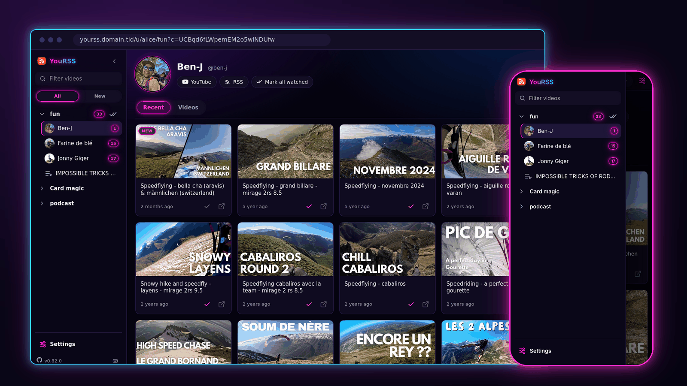
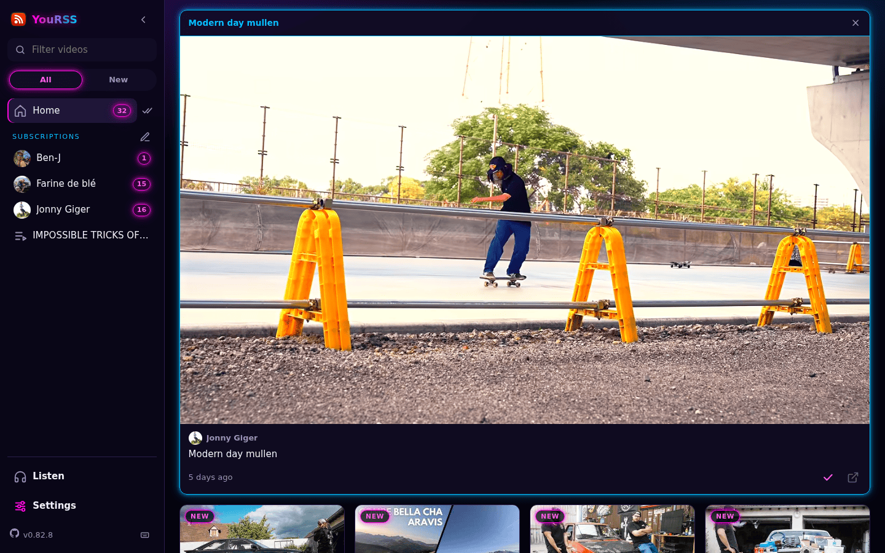
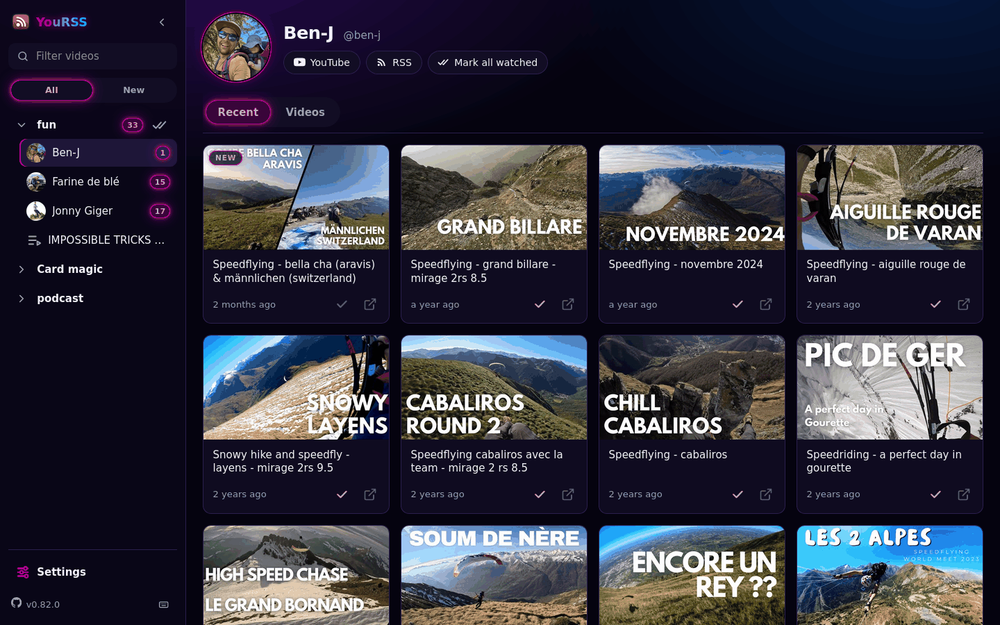
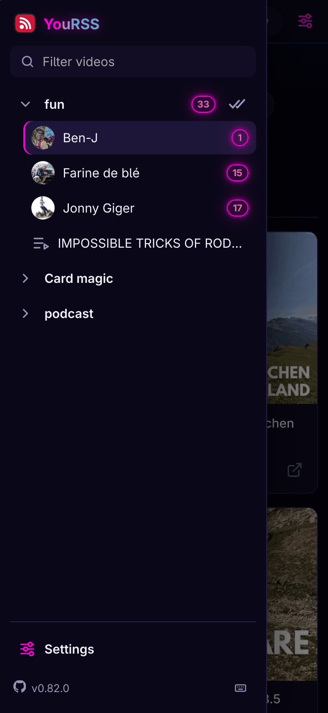
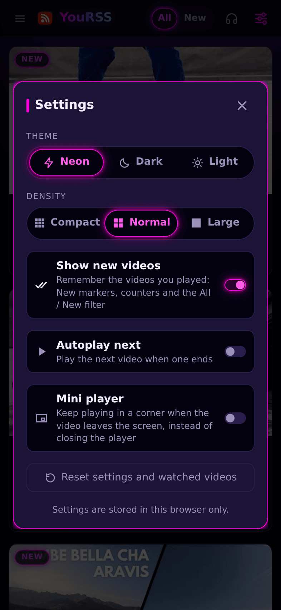
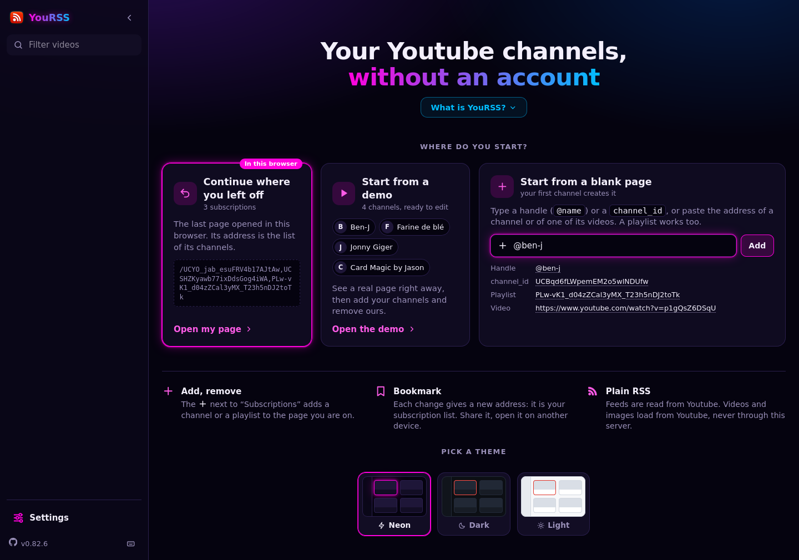
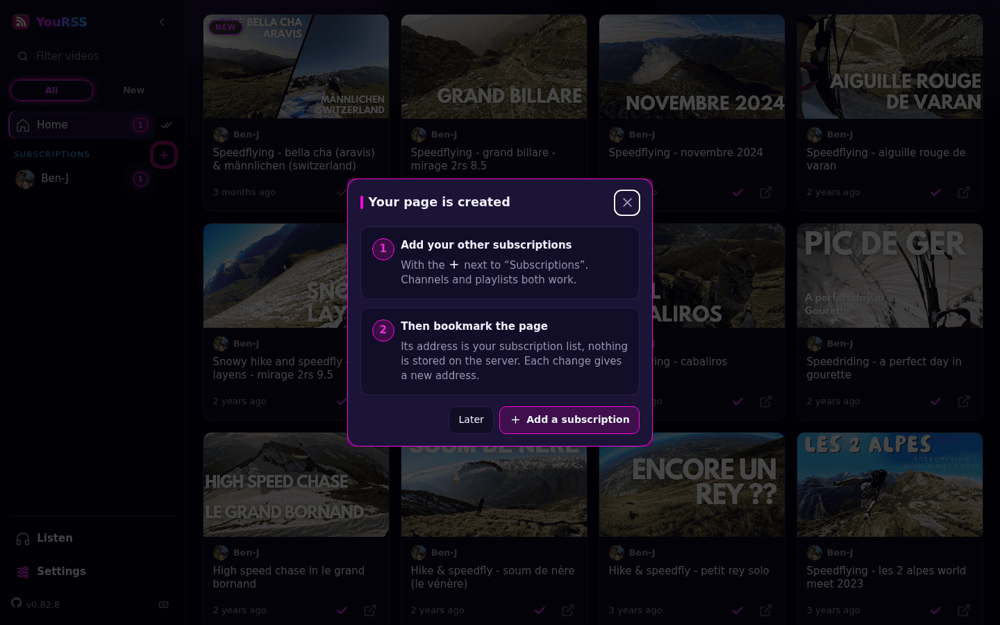
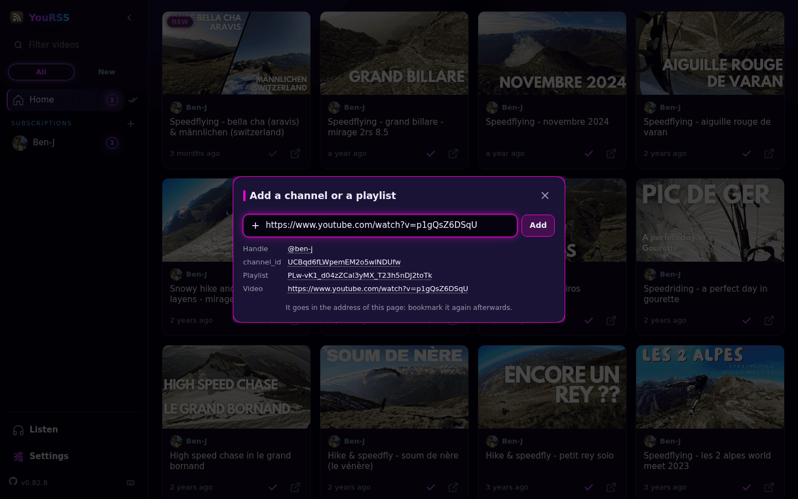
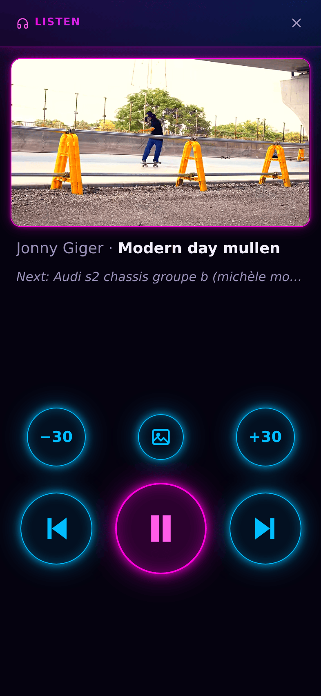
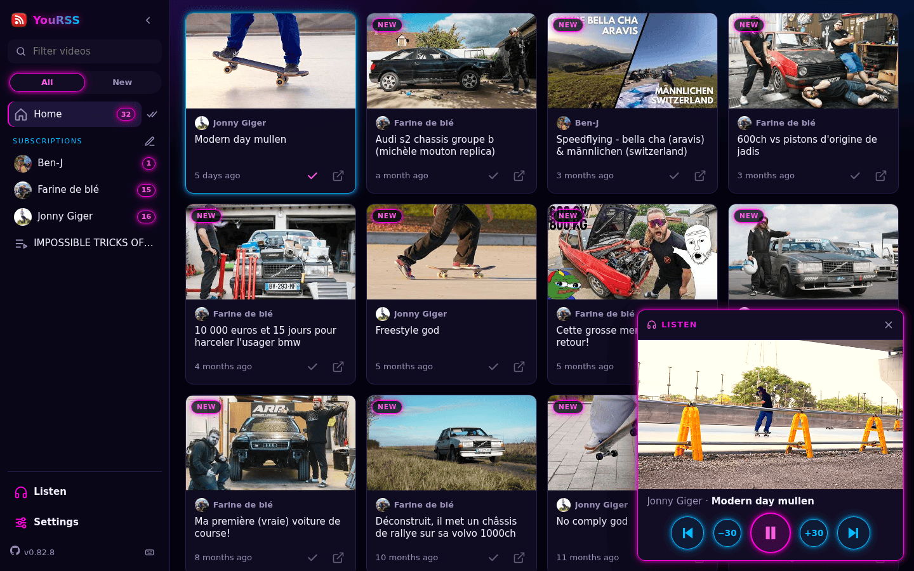

# YouRSS

> A minimal Youtube RSS feed viewer for your browser: the latest videos of the channels you chose, on one page. No account, no registration, no ads, no recommendations, no tracking.



<details>
<summary>More screenshots</summary>

| The player takes the whole row | A channel, opened inside its folder |
| --- | --- |
|  |  |

<p align="center">
  
  
</p>

</details>

## 🚀 Try the demo

**https://yourss.onrender.com**

> This demo is a public instance, shared by everyone and hosted on a free plan: it sleeps when nobody uses it, so the first page may take about a minute to show up. It comes without any guarantee and can be limited or stopped at any time: to follow your channels every day, [install your own](#-install).

## ✨ Features

### 🧱 Build your own page

No account: your subscriptions are the address of your page.

| 1. Start from the home page | 2. Your page is created | 3. Add the rest, then bookmark |
| --- | --- | --- |
|  |  |  |

- the home page offers three ways to start: a demo page, ready to edit, a blank page made from your first channel, or the last page opened in this browser
- then the **+** next to *Subscriptions* adds the others
- a channel is added by its handle (`@name`), its *channel_id*, its address or the address of one of its videos; a playlist by its id or its address
- a subscription is removed from the sidebar
- each change gives a new address, made of ids only (example https://yourss.domain.tld/UCVooVnzQxPSTXTMzSi1s6uw,PLw-vK1_d04zZCal3yMX_T23h5nDJ2toTk): bookmark it, share it, open it on another device. Nothing is stored on the server

The administrator of an instance can also declare *users*, who hold *pages*, named lists of channels and playlists shown as folders (`/u/<user>/<page>`) and optionally published under a short name (`/p/<name>`), and can turn custom pages off.

### 📰 One page for all your subscriptions

A page shows the last 15 videos of each channel and what the feed of each playlist holds, sorted by date.

Turn on *Show new videos* in the settings and the videos you played for a few seconds are marked as watched: on the next visit a `NEW` marker and a counter per channel show what you have not seen yet, and an *All / New* switch hides the rest. This is stored in your browser only.

### 🎧 Listen to a page, in the car or while you work

<p align="center">
  
  
</p>

*Listen* plays the videos of the page one after the other, as a playlist of music.

- **on a phone** it takes the whole screen, with finger sized commands for a phone on a car mount: previous, play / pause, next, −30 / +30 seconds (hold them to jump further, a bubble shows how far), the channel and the title, the next one. The screen stays on while it plays (an embedded Youtube player stops when the screen locks), and a button shows the thumbnail instead of the video
- **on desktop** it is a mini player in a corner, the page stays below: a click on a video plays it there
- start it with the headphones button, the `l` key or 🎧 in the mini player, or add `?listen` to the address of a page: bookmark it, or add it to the home screen of your phone
- *Listen* at the top of the player chooses what to listen to: the whole page, or a channel of the page and one of its tabs (Recent, Videos, Shorts, Streams). Opening another folder or channel keeps listening: its videos become the playlist
- ✕ or `Esc` stops it

### ▶️ Play in the page

Click a thumbnail to play: the player takes the whole row, or the whole screen on a phone. A link on each card opens the video on Youtube. The next video can be played automatically.

### 📺 Keep watching while you browse

Turn on the *Mini player* in the settings: when you scroll away, the video keeps playing in a corner of the screen, without a gap, while you browse the rest of the page. Its card shows where it comes from, a click (or ↩) brings you back to it, 🎧 turns it into the listen player, and with *Autoplay next* the next video starts in the mini player. Without it, the player is closed as soon as its card leaves the screen. Opening another folder or channel closes it.

### 📂 Channels and playlists, inside the page

Click a channel in the sidebar to browse it without leaving your page: its recent videos, all its videos, its shorts and its streams. A playlist opens the same way.

### 🎁 And also

- three themes (neon, dark, light), to pick on the home page or in the settings, and three density levels
- works on desktop and mobile, can be added to the home screen of a phone
- instant search in the titles
- keyboard shortcuts: arrows move in the grid, `Space` plays, `n`/`p` play the next/previous video, `l` listens, `Shift`+`↑`/`↓` change channel… press `?` for the list
- light: server-rendered pages, [htmx](https://htmx.org/), one CSS file and a few JavaScript modules, no framework, no build step

## 💡 Philosophy

Youtube publishes an RSS feed for every channel. RSS is an open and stable way to share content, it has been for decades: it lets *you* choose how, and with which application, you follow what you like.

*YouRSS* is a small RSS client for the browser, nothing more:

- **no account**: the channels you follow are in the *URL*, a page can be bookmarked and shared as is
- **nothing but the content you chose**: no ads, no suggested videos
- **nothing kept on the server**: no database, no session, no cookie; your settings and the videos you watched stay in your browser
- **straight from Youtube**: thumbnails, avatars and the player are loaded by your browser, the server never relays them

# 📦 Install

## 🐍 From the source

First, you need [uv](https://docs.astral.sh/uv/), see [installation documentation](https://docs.astral.sh/uv/getting-started/installation/):

```sh
$ git clone https://github.com/essembeh/YouRSS
$ cd YouRSS
$ uv sync
$ uv run --env-file .env -- fastapi dev src/yourss/main.py

# or if you use just
$ just run
```

Then visit [http://localhost:8000/](http://localhost:8000/)

## 🐳 From docker

Using Docker you can run the latest image build on the latest commit:

```sh
$ docker run -d --name yourss -p 8000:8000 ghcr.io/essembeh/yourss:main
```

Then visit [http://localhost:8000/](http://localhost:8000/)

## ☸️ Install Helm Chart for Kubernetes

You need an access to a Kubernetes cluster and `helm` tool installed.
```sh
# add the helm repository
$ helm repo add yourss https://essembeh.github.io/YouRSS/ 
# get the values.yaml
$ helm show values yourss/yourss > myvalues.yaml
# edit the values for your needs
$ vim myvalues.yaml
# install release
$ helm install my-yourss yourss/yourss -f myvalues.yaml
```

> Note: you need to add an *Ingress* to access the *Service* from outside your cluster.

You can then forward the service to test it:

```sh
$ kubectl port-forward service/my-yourss 8000:http
```

Then visit [http://localhost:8000/](http://localhost:8000/)

# ⚙️ Configuration

*YouRSS* can be configured using environment variables.

| VARIABLE | DEFAULT | HELM VALUE | DESCRIPTION |
|----------|---------|------------|-------------|
| YOURSS_CUSTOM_PAGES_ENABLED | `True` | `yourss.customPagesEnabled` | Let visitors build their own page by putting channels in its URL. If set to `false`, the home page and the multi channel pages show an error (`403`), and only the *user* pages remain |
| YOURSS_MAX_PAGE_ITEMS | `12` | `yourss.maxPageItems` | How many channels and playlists the address of a custom page may hold. A longer address is refused (`422`) before anything is asked to Youtube. Configured pages are not limited |
| YOURSS_API_DOCS_ENABLED | `False` | `yourss.apiDocsEnabled` | If set to `true`, the generated API documentation is served at `/docs`, `/redoc` and `/openapi.json`. Meant for development: it is off in the docker image and in the Helm chart |
| YOURSS_USERS_FILE |  | `yourss.users` | The users of the instance and their pages, in a YAML file (the Helm chart builds it from the values and stores it in a *Secret*) |
| YOURSS_CLEAN_TITLES | `False` | `yourss.cleanTitles` | If set to `true`, videos titles are cleaned to prevent UPPERCASE TITLES |
| YOURSS_CACHE_ENABLED | `False` | `yourss.cacheEnabled` | Keep the RSS feeds and the channel metadata (name, avatar) on disk. A feed younger than `YOURSS_CACHE_RSS_TTL` is served without asking Youtube, and when the fetch fails (Youtube's daily transient `404` windows, errors, timeouts) a feed younger than `YOURSS_CACHE_RSS_FALLBACK_TTL` is served instead of the error. Off by default: nothing is cached, every page load fetches its feeds and scrapes a page per channel |
| YOURSS_CACHE_FOLDER |  | `yourss.cacheFolder` | Where the cache lives (created at startup, the application refuses to start if it cannot write there). If unset, a temporary folder `yourss-*` is created at startup |
| YOURSS_CACHE_RSS_TTL | `PT30M` | `yourss.cacheRssTtl` | How long a cached feed is served without asking Youtube (ISO-8601 duration, e.g. `PT30M`, or a number of seconds) |
| YOURSS_CACHE_RSS_FALLBACK_TTL | `PT48H` | `yourss.cacheRssFallbackTtl` | How long a cached feed may replace a failed fetch, at least `YOURSS_CACHE_RSS_TTL`. An older feed is deleted and the error is propagated |
| YOURSS_CACHE_METADATA_TTL | `P7D` | `yourss.cacheMetadataTtl` | How long the name and avatar of a channel are served without scraping its page on Youtube (ISO-8601 duration or seconds). When the scrape fails, the cached ones are served whatever their age. Browsers keep the redirect to an avatar as long |
| YOURSS_LOGIN_TTL | `P90D` | `yourss.loginTtl` | How long a browser stays logged in to a user behind a password once its form is filled (ISO-8601 duration or seconds). Behind a TLS proxy, the cookie is `Secure` only when the proxy sends `X-Forwarded-Proto` |
| YOURSS_WARMUP_ENABLED | `False` | `yourss.warmupEnabled` | With the cache on, refresh the feeds of every configured page in the background: a first round at startup, then one every `YOURSS_CACHE_RSS_TTL` minus a minute, so that a visitor always finds fresh feeds, Youtube's bad hours included (the fallback cache). It asks Youtube whether anyone visits or not. Each process refreshes its own cache: run one worker per cache |

> Note: in the users file, a channel is a *channel_id* (24 characters, like `UCa_Dlwrwv3ktrhCy91HpVRw`) or a handle (like `@JonnyGiger`), and a playlist is its id (`PL…`). The address of a page only holds ids.

See [`.env`](./.env) for example.

## 👤 Configure users and pages

A *user* holds *pages*, named lists of channels and playlists, which become its folders:
`http://my-yourss-instance/u/alice/fun`. The sidebar lists the folders, one open at a time, each with its own Home;
`http://my-yourss-instance/u/alice` opens the last folder visited in this browser. A user can be protected by a *password* (plain text or argon2 hash): its pages answer a login
form, which keeps the browser logged in for `YOURSS_LOGIN_TTL` with a signed cookie (it works in a web app added to the
iOS home screen, where HTTP Basic does not), and HTTP Basic credentials (`curl -u`) are still accepted. Changing the
password logs out every browser.

A page can be *published* under a name, at its own address, easier to type and to remember than an address full
of ids: `http://my-yourss-instance/p/fun` instead of
`http://my-yourss-instance/UCVooVnzQxPSTXTMzSi1s6uw,UCQsmxaMzYr76Yd1iqMEq8TA`. A public page is readable by anyone,
even when its user is behind a password; published names are unique across the instance.

To configure them:
- set `YOURSS_USERS_FILE` and point to a *YAML* file where you'll declare your *users* and their *pages*
- see [sample `users.yaml`](./samples/users.yaml) for example

```yaml
users:
  - name: alice              # letters, digits, - and _, 32 characters at most: /u/alice/fun, /u/alice/cards
    pages:
      - name: fun
        publish: fun         # optional, also published at /p/fun
        channels:
          - "@ben-j"
          - "@JonnyGiger"
      - name: cards
        channels:
          - UCQsmxaMzYr76Yd1iqMEq8TA
```

> Migrating from 0.83.0: the top level `pages` are gone, a page now lives in the user listing it, with its `channels`; the
> `label` is gone, the name is what the sidebar shows. A page held by several users is copied into each one; a page that had its own address (no `visible: false`) gets a
> `publish` name in one of them, its former name to keep `/p/<name>` working.

## 🚫 Disable custom pages

By default any visitor can build a page by putting channels in its URL, and the home page explains how.
The administrator of an instance can turn this off, for example to keep the instance for the *user* pages declared in the configuration:

- set `YOURSS_CUSTOM_PAGES_ENABLED=false`, or `yourss.customPagesEnabled: false` in the Helm values
- the home page and the multi channel pages (`/UCVooVnzQxPSTXTMzSi1s6uw,UCQsmxaMzYr76Yd1iqMEq8TA`) then show an error (`403`), and channels can no longer be added
- the configured pages (`/p/<name>`) and users (`/u/<name>`) keep working

> Note: this does not make the instance private, the routes which feed the pages (`/htmx/...`) still answer for any channel.

# 📖 Usage

- the home page `http://yourss.local/` explains how to build your own page: open the demo page, or add your first channel
- you can browse a single channel with: `http://yourss.local/UCVooVnzQxPSTXTMzSi1s6uw`
- you can browse multiple channels and playlists in a single page, their ids separated by commas: `http://yourss.local/UCVooVnzQxPSTXTMzSi1s6uw,UCQsmxaMzYr76Yd1iqMEq8TA`
- an address only holds ids: to add a channel by its handle (`@jonnygiger`) or its address, use the add form, which resolves it
- click a channel in the sidebar of a page to browse its homepage (recent videos, videos, shorts, streams)
- if you defined some *pages*, for example `fun`, the page can be accessed at `http://yourss.local/p/fun`, and a folder of a *user* at `http://yourss.local/u/alice/fun`

> Note: replace `yourss.local` with the URL of your *YouRSS* instance.

# 🔗 External links

Special thanks to the amazing python frameworks: [FastAPI](https://fastapi.tiangolo.com/), [asyncio](https://docs.python.org/fr/3/library/asyncio.html), [httpx](https://www.python-httpx.org/) and [Pydantic](https://docs.pydantic.dev/) ♥️


- Youtube player API: https://developers.google.com/youtube/player_parameters
